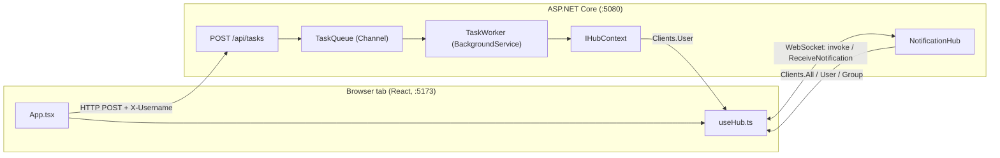

# Architecture

How the SignalR notification demo is put together. For how to run it, see [README.md](README.md). For the talk track, see [PRESENTATION.md](PRESENTATION.md).

## The big picture

Two processes, one open connection per browser tab, and one outbound event.



There are two ways **in** and one way **out**:

| Direction | Path | Used for |
|---|---|---|
| In | Hub method call over the WebSocket (`invoke`) | Broadcast, direct, group sends, join and leave |
| In | `POST /api/tasks` over plain HTTP | Starting the background task |
| Out | `ReceiveNotification` event, server to client | Every notification, whatever triggered it |

Because everything leaves through the same event with a `kind` field, the client needs only one handler. That handler feeds the list, the toast and the unread count.

## Server (`server/`)

| File | What it holds |
|---|---|
| `Program.cs` | Wiring: SignalR, CORS, the user id provider, the queue and worker, the hub route and the `202` endpoint |
| `NotificationHub.cs` | The client-callable methods: `SendBroadcast`, `SendToUser`, `JoinGroup`, `LeaveGroup`, `SendToGroup` |
| `Notifications.cs` | The payload (`AppNotification`), the typed client interface, `QueryStringUserIdProvider`, `TaskQueue`, `TaskWorker` |

### The hub

`NotificationHub : Hub<INotificationClient>` is a **typed hub**. The only thing the server can call on a client is `ReceiveNotification`, so a misspelled event name is a compile error instead of a silent failure.

SignalR creates a **new hub instance for every call**, so the hub keeps no state. Anything that must outlive a call lives in a singleton (the queue, the user id provider).

The hub validates input itself: it trims messages, rejects empty ones and ones over 280 characters, and requires a group or user name. The input's `maxLength` in the UI does not stop someone calling the hub directly, so the server is the real check. A rejection is a `HubException`, which reaches the client as a rejected `invoke`.

### Who is "alice"? (identity)

`Clients.User("alice")` needs SignalR to know which user each connection belongs to. `QueryStringUserIdProvider` answers that by reading `?username=` from the connection URL and normalising it (trim, lower-case, because user ids are case sensitive).

**This is deliberately fake.** Anyone can connect as anyone. A real app would authenticate and read the user id from a token. The same `IUserIdProvider` seam would stay in place.

One user can have several connections (several tabs), and `Clients.User` reaches all of them.

### Delivery targets

| Call | Reaches | Kind |
|---|---|---|
| `Clients.All` | Every connection, including the sender | `broadcast` |
| `Clients.User(name)` | Every connection of that username | `user` |
| `Clients.Group(name)` | Connections currently in the group | `group` |
| `IHubContext...Clients.User(name)` (from the worker) | Every connection of that username | `task` |

### The background task path

1. `POST /api/tasks` reads the username from the `X-Username` header, builds a `TaskJob`, writes it to the `TaskQueue` and returns **202 Accepted** at once.
2. `TaskQueue` wraps a bounded `Channel<TaskJob>` (capacity 100).
3. `TaskWorker` is a `BackgroundService` that reads the channel, waits 10 seconds and then pushes "Task completed" through `IHubContext<NotificationHub, INotificationClient>`.

Why it is built this way:

- **The request does not wait.** Long work leaves the request, which is the point of the demo.
- **`IHubContext`, not `Hub`.** Outside a hub there is no `Caller` or `Others`, so the worker targets the user by name.
- **The job carries the username.** `HttpContext` is gone by the time the worker runs.
- **Jobs run concurrently** (`Parallel.ForEachAsync`, up to 8). A plain loop would make a second task finish after 20 seconds.
- **Each job has its own try/catch.** By default an unhandled exception in a `BackgroundService` stops the whole host.
- **The delay uses the stopping token**, so Ctrl+C is quick.

### CORS

SignalR connections send credentials, and credentials require explicit origins, so the policy lists `http://localhost:5173` and `http://127.0.0.1:5173` and uses `AllowCredentials()`. `AllowAnyOrigin` would not work with credentials. `UseCors` is called before `MapHub`.

## Client (`client/src/`)

| File | What it holds |
|---|---|
| `types.ts` | `AppNotification` type, `kindLabel`, and the constants (server URL, hub path, 280 limit, list cap of 50) |
| `useHub.ts` | The connection lifecycle and all SignalR code |
| `App.tsx` | The UI. It never imports `@microsoft/signalr` directly |
| `App.css` | Plain CSS, no UI library |

The type is called `AppNotification` because `Notification` is already a browser global (the Web Push API this demo is **not** about).

### The connection hook (`useHub.ts`)

`useHub(username)` owns one `HubConnection` and exposes status, the list, the unread count, groups and the actions.

- **One connection per username.** The effect depends on `[username, attempt]`. Changing the username, or pressing Reconnect, builds a brand new connection.
- **StrictMode safe.** In development React runs mount, cleanup, mount. `start()` is deferred by one macrotask and cancelled in cleanup, so only the second mount opens a real connection. Cleanup waits for an in-flight `start()` to settle before calling `stop()`, otherwise SignalR logs a "stopped during negotiation" error.
- **Retries the first connect.** `withAutomaticReconnect` does not cover a failed first `start()`, so the hook retries it every 2 seconds. That is why a tab opened before the server still connects by itself.
- **Never gives up reconnecting.** The reconnect policy backs off from 1 second up to 10 seconds with no limit. SignalR's default stops after about 40 seconds.
- **Re-joins groups.** A reconnect gets a new `connectionId`, and group membership belongs to a connection id, so the hook re-joins its remembered groups after every connect and reconnect.
- **De-duplicates.** A repeated notification id is ignored, and the toast reuses the notification id as its own id.

### Status

```
connecting ──start ok──► connected ──connection lost──► reconnecting ──ok──► connected
     │                                                        │
     └─ retry every 2s while the server is down               └─ keeps retrying (no give-up)
```

`disconnected` only happens if the connection is closed for good; the UI then offers a Reconnect button. Sending is disabled unless the status is `connected`.

### Fake login and per-tab identity

The username is stored in `sessionStorage`, not `localStorage`. `sessionStorage` is per tab, so two tabs can be two different users. `localStorage` would make every tab the same user and break the two-tab demo.

## A message's journey

Tab A (alice) sends a group message to `team`:

1. `App.tsx` calls `hub.invoke("SendToGroup", "team", text)`.
2. The call travels over alice's WebSocket to a fresh `NotificationHub` instance.
3. The hub validates the text, builds an `AppNotification` (`kind: "group"`, `from: "alice"` taken from `Context.UserIdentifier`) and calls `Clients.Group("team").ReceiveNotification(...)`.
4. SignalR delivers it to every connection in `team`.
5. In each receiving tab, the `ReceiveNotification` handler in `useHub.ts` adds it to the list (newest first, capped at 50), bumps the unread count and shows a toast.

The background task is the same last two steps, but started from step 0: an HTTP `POST`, a queue, a worker and an `IHubContext` call.

## Decisions and trade-offs

| Decision | Why | Cost |
|---|---|---|
| Fake username login | Keeps focus on SignalR, not auth | Spoofable by design |
| In memory only | Smallest possible demo | Restart loses queued tasks and groups; one instance only |
| One `ReceiveNotification` event with a `kind` | One client handler | The client branches on `kind` for labels and styles |
| Typed hub | Event names checked at compile time | One extra interface |
| Client re-joins groups after reconnect | Simple, visible in the client code | A short gap between reconnecting and re-joining |
| Plain CSS and `sonner` for toasts | No styling framework to learn | Hand-written styles |
| Fixed ports 5080 and 5173, `strictPort` | The CORS policy lists exact origins | Changing a port means editing several files |

## Known limits

- **No delivery guarantee.** Anything sent while a client is disconnected is lost. The UI says so after a reconnect.
- **Spoofable identity.** See above.
- **Not horizontally scalable as is.** With several server instances, a user's connection might be on a different server than the sender. That needs a backplane (Redis or Azure SignalR Service).
- **The task queue is lost on restart.** It lives in memory.
- **Tested in Chromium only.**

## Where to go next

- JWT authentication over SignalR. WebSockets cannot set headers, so the token travels in the query string and is read in `OnMessageReceived`.
- A persistent store, so notifications survive a restart and a client can catch up after reconnecting.
- A backplane, to run more than one server.
